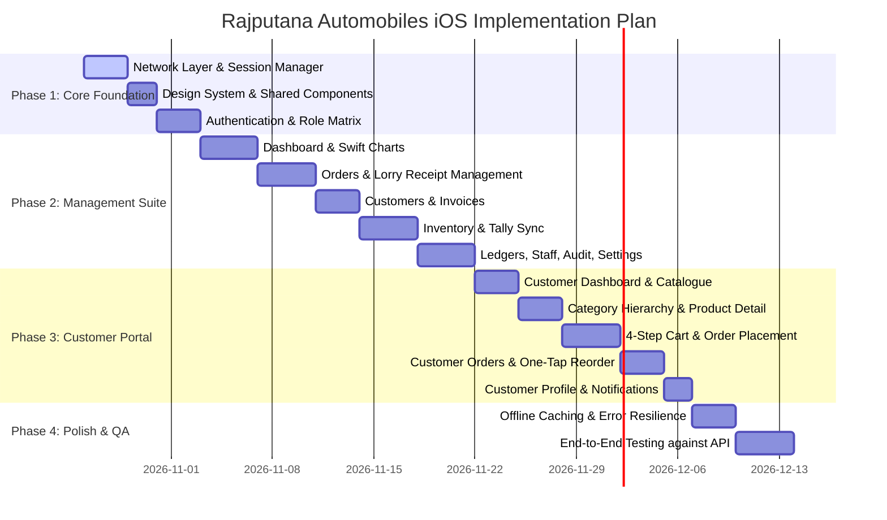

# Rajputana Automobiles — iOS Application Implementation Blueprint

> Complete engineering specification, architectural roadmap, and technical design for cloning the Rajputana Automobiles Android ERP Companion into a native SwiftUI iOS app.

---

## 1. Architectural Strategy & Technology Mapping

To deliver an identical, pixel-perfect, and high-performance native iOS app, we map Android components and patterns directly to modern Swift & SwiftUI equivalents:

| Architectural Concern | Android Pattern (Source) | Modern iOS Equivalent (Target) |
|---|---|---|
| **Language & UI** | Kotlin + Jetpack Compose + Material 3 | **Swift 5.10 / 6 + SwiftUI (iOS 17+)** |
| **State Management** | StateFlow + Sealed `UiState` + `@HiltViewModel` | **`@Observable` classes (Observation Framework) + Swift Enums (`ViewState<T>`)** |
| **Dependency Injection** | Dagger Hilt (`@Singleton`, `@Inject`) | **Swift Dependency Container / `@Environment` + Protocol Abstractions** |
| **Networking & HTTP** | Retrofit + OkHttp + Gson | **Native `URLSession` + `Codable` (or lightweight `Alamofire`) + `AsyncSequence`** |
| **Session Persistence** | `SharedPreferences` (plain text) | **`KeychainAccess` (encrypted JWT) + `UserDefaults` (user preferences)** |
| **Async Concurrency** | Kotlin Coroutines + `Dispatchers.Default` | **Swift Structured Concurrency (`async/await`, `TaskGroup`, `actor`)** |
| **Navigation** | Navigation Compose (`NavHost`, routes) | **`NavigationStack` + `NavigationPath` with Hashable enum destinations** |
| **Data Visualization** | MPAndroidChart (Line) + Custom Compose Pie | **Apple `Charts` Framework (Swift Charts `LineMark`, `PointMark`, `SectorMark`)** |
| **Image Loading** | Glide Compose (`@Composable AppImage`) | **`AsyncImage` with custom memory/disk cache (`ImageCacheService`)** |
| **Document / PDF Handling** | Offscreen WebView + `PrintManager` | **`PDFKit` (`PDFView`), `UIPrintInteractionController`, and `QuickLook` (`QLPreviewController`)** |
| **Asset Sharing** | `app_logo.png`, `states_and_cities.json` | **Asset Catalog (`Assets.xcassets`) & Bundled JSON resource** |

---

## 2. Target iOS Folder Structure

The Xcode project will follow a feature-driven, clean-architecture structure:

```
Rajputana Automobiles/
├── App/
│   ├── Rajputana_AutomobilesApp.swift       // App lifecycle & container initialization
│   ├── AppEnvironment.swift                 // Global dependencies & configuration
│   └── LaunchScreen.storyboard
├── Core/
│   ├── Network/
│   │   ├── APIEndpoint.swift                // REST path, HTTPMethod, headers, query items
│   │   ├── NetworkService.swift             // URLSession executor with async/await
│   │   ├── AuthInterceptor.swift           // Auto-injection of Bearer token
│   │   └── APIError.swift                   // Typed HTTP & decoding errors
│   ├── Storage/
│   │   ├── KeychainStore.swift              // Secure storage for JWT token
│   │   └── SessionManager.swift             // Session state, heartbeat, permission observer
│   ├── DesignSystem/
│   │   ├── AppColors.swift                  // Hex-mapped Color constants matching Android
│   │   ├── AppTypography.swift              // Fluid font sizing matching AppTextSize
│   │   ├── AppComponents/
│   │   │   ├── ShimmerModifier.swift        // Skeleton loading shimmer
│   │   │   ├── RemoteImageView.swift        // Cached image loader with watermarking
│   │   │   ├── StatusBadge.swift            // Approved/Rejected/Pending chips
│   │   │   └── SearchBarView.swift          // Reusable search inputs
│   ├── Navigation/
│   │   ├── AppRoute.swift                   // All hashable navigation destinations
│   │   └── TabItem.swift                    // Role-specific bottom tab descriptors
│   └── Utilities/
│       ├── CurrencyFormatter.swift          // Indian Rupee (₹) formatting & Lakh (L) converter
│       ├── DateFormatterExtensions.swift    // ISO 8601 & Tally date parsers
│       └── DistrictDataLoader.swift         // Parser for states_and_cities.json
├── Models/
│   ├── Auth/
│   │   ├── AuthSession.swift                // Token, user identity, customer identifiers
│   │   └── RolePermissions.swift           // ModulePermissions matrix & WorkspaceRole
│   ├── Dashboard/
│   │   ├── DashboardMetrics.swift           // Aggregated KPI data model
│   │   └── PaymentDueModels.swift           // Aging buckets (0-30, 31-60, 60+)
│   ├── Customers/
│   │   ├── Customer.swift                   // Master customer profile & balance
│   │   └── Invoice.swift                    // Tax invoices & line items
│   ├── Orders/
│   │   ├── Order.swift                      // Order model, shipping info, items
│   │   └── LorryReceipt.swift               // LR metadata & file tracking
│   ├── Inventory/
│   │   ├── InventoryItem.swift              // Stock, pricing tiers, specifications
│   │   └── TallySyncStatus.swift
│   ├── Cart/
│   │   ├── CartModels.swift                 // CartItem, CartApiRequest, CartApiResponse
│   │   └── PlaceOrderModels.swift           // Checkout request & response
│   ├── Ledgers/
│   │   ├── LedgerSummary.swift              // Party balances
│   │   └── DetailedLedger.swift             // Vouchers & bills receivable
│   ├── Staff/
│   │   └── StaffMember.swift                // Internal employee details
│   ├── Audit/
│   │   └── ActivityLog.swift                // System audit trail
│   ├── Settings/
│   │   └── CompanyProfile.swift             // Company metadata & watermark settings
│   └── Notifications/
│       └── NotificationItem.swift           // System alerts, unread status, order links
├── Services/
│   ├── AuthService.swift
│   ├── DashboardService.swift
│   ├── CustomerService.swift
│   ├── OrderService.swift
│   ├── InventoryService.swift
│   ├── CartService.swift
│   ├── LedgerService.swift
│   ├── StaffService.swift
│   ├── SettingsService.swift
│   └── NotificationService.swift
├── Features/
│   ├── Auth/
│   │   ├── Views/LoginView.swift
│   │   └── ViewModels/LoginViewModel.swift
│   ├── Shell/
│   │   ├── Views/MainAppShell.swift         // Management shell (Drawer + TopBar + Tabs)
│   │   ├── Views/CustomerAppShell.swift     // Customer shell (Custom toolbar + Tabs)
│   │   └── ViewModels/AppShellViewModel.swift // Badge poller (Cart & Notifications)
│   ├── Dashboard/
│   │   ├── Views/DashboardView.swift
│   │   ├── Views/GrossSalesChartView.swift  // Swift Charts 7-month rolling line
│   │   ├── Views/AgingPieChartView.swift    // Swift Charts sector mark aging
│   │   └── ViewModels/DashboardViewModel.swift
│   ├── Customers/
│   │   ├── Views/CustomerListView.swift
│   │   ├── Views/CustomerDetailView.swift
│   │   ├── Views/EditCustomerSheet.swift
│   │   └── ViewModels/CustomerViewModel.swift
│   ├── Orders/
│   │   ├── Views/OrderListView.swift
│   │   ├── Views/OrderDetailView.swift
│   │   ├── Views/LorryReceiptSheet.swift
│   │   └── ViewModels/OrderViewModel.swift
│   ├── Inventory/
│   │   ├── Views/InventoryListView.swift
│   │   ├── Views/InventoryDetailView.swift
│   │   ├── Views/QuickEditSheet.swift
│   │   ├── Views/PhotoManagerSheet.swift
│   │   └── ViewModels/InventoryViewModel.swift
│   ├── CustomerPortal/
│   │   ├── Catalog/
│   │   │   ├── Views/CustomerCatalogView.swift
│   │   │   └── Views/ProductCardView.swift
│   │   ├── Category/
│   │   │   ├── Views/CategoryAccordionView.swift
│   │   │   ├── Views/CategoryDetailView.swift
│   │   │   └── Views/ProductDetailView.swift
│   │   ├── Cart/
│   │   │   ├── Views/CartFlowView.swift      // 4-step stepper container
│   │   │   ├── Views/CartStepView.swift
│   │   │   ├── Views/AddressStepView.swift
│   │   │   ├── Views/PaymentStepView.swift
│   │   │   ├── Views/OrderConfirmationView.swift
│   │   │   └── ViewModels/CartViewModel.swift
│   │   └── Orders/
│   │       ├── Views/CustomerOrderListView.swift
│   │       ├── Views/CustomerOrderDetailView.swift
│   │       └── ViewModels/CustomerOrdersViewModel.swift
│   ├── Ledgers/
│   │   ├── Views/LedgerSummaryView.swift
│   │   ├── Views/DetailedLedgerView.swift
│   │   └── ViewModels/LedgerViewModel.swift
│   ├── Staff/
│   │   ├── Views/StaffListView.swift
│   │   ├── Views/AddEditStaffSheet.swift
│   │   └── ViewModels/StaffViewModel.swift
│   ├── Audit/
│   │   ├── Views/AuditLogsView.swift
│   │   └── ViewModels/AuditLogsViewModel.swift
│   ├── Settings/
│   │   ├── Views/SettingsView.swift
│   │   ├── Views/WatermarkSheet.swift
│   │   └── ViewModels/SettingsViewModel.swift
│   ├── Profile/
│   │   ├── Views/UserProfileView.swift
│   │   └── ViewModels/UserProfileViewModel.swift
│   └── Notifications/
│       ├── Views/NotificationListView.swift
│       └── ViewModels/NotificationViewModel.swift
└── Resources/
    ├── Assets.xcassets                       // app_logo, icons, colors
    └── states_and_cities.json               // Ported district dataset
```

---

## 3. Design System & Theme Specification

### 3.1 Color Palette (`AppColors.swift`)
Direct hex translation guaranteeing visual parity with Android:
- **Primary Brand:** `#3158D4` (Light `#3D5AFE`, Dark `#2F5CFF`, Bg `#EFF3FF`, Soft `#EAEAFF`)
- **Page Backgrounds:** `#F4F6F9`, Surface `#FFFFFF`, Surface Gray `#F8FAFC`
- **Text:** Slate Dark `#172033`, Body `#475569`, Gray `#6F7888`, Muted `#94A3B8`
- **Borders & Dividers:** Border `#E4E8EF`, Faint `#E8EDF3`, Divider `#F0F3F8`
- **Status Tints:**
  - *Success (Approved/Synced):* `#00A875`, Soft `#ECFDF5`, Border `#A7F3D0`
  - *Warning (Pending):* `#D97706`, Soft `#FFFBEB`, Border `#FDE68A`
  - *Error (Rejected/Overdue):* `#DC2626`, Soft `#FEF2F2`, Border `#FECACA`
  - *Aging Chart:* Current `#00BE87`, Due Soon `#FF9F0A`, Overdue `#EF4349`

---

## 4. Key Engineering Modules

### 4.1 Networking & Session Management
- **Actor-Based SessionStore:**
  A Swift `actor SessionStore` manages the active `AuthSession`, token storage in Keychain, and TTL validation.
- **Background Heartbeat Task:**
  ```swift
  func startHeartbeat() {
      Task {
          while !Task.isCancelled {
              try? await Task.sleep(nanoseconds: 30_000_000_000) // 30 seconds
              let isValid = await authService.checkHeartbeat()
              if !isValid {
                  await signOut()
                  break
              }
          }
      }
  }
  ```
- **Permission Guard Modifier:**
  A custom SwiftUI ViewModifier `.requirePermission(module: .inventory, action: .view)` that displays `AccessDeniedView` if unauthorized.

### 4.2 Dashboard Aggregation & Charts
- **Swift Charts Gross Sales Trends:**
  ```swift
  Chart {
      ForEach(monthlySalesData) { point in
          LineMark(
              x: .value("Month", point.monthLabel),
              y: .value("Revenue", point.revenueInLakhs)
          )
          .foregroundStyle(Color(hex: "3158D4"))
          
          LineMark(
              x: .value("Month", point.monthLabel),
              y: .value("Target", point.targetInLakhs)
          )
          .foregroundStyle(Color(hex: "00A875").opacity(0.8))
          .lineStyle(StrokeStyle(lineWidth: 2, dash: [4, 4]))
      }
  }
  .chartYScale(domain: 0...150) // Capped at ₹150 Lakhs
  ```
- **Receivables Aging Pie:**
  Implemented with Swift Charts `SectorMark` or custom SwiftUI arcs for iOS 16+.

### 4.3 Customer Live Cart & Order Placement
- **Real-Time Synchronized Cart:**
  - `GET /api/cart?identifier={id}` loads current cart state.
  - Client verifies stock availability against in-memory inventory items before allowing stepper increments.
  - Custom headers formatted precisely for `POST /api/orders`:
    - `X-ERP-Client-Version`: `1.4.0`
    - `x-user-role`: `customer`
    - `x-customer-id`: Customer Code or UID
    - `x-customer-name`: URL-encoded name
- **4-Step Flow Coordinator:**
  Controlled with a clean SwiftUI tab/step transition with smooth page animations and step-indicator bar.

### 4.4 Lorry Receipt & Invoice Document Handling
- **LR File Upload:**
  - Supports photo capture via `PhotosPicker` or PDF selection via `UIDocumentPickerViewController`.
  - Converts data to base64 `data:application/pdf;base64,...` or `data:image/jpeg;base64,...`.
  - Custom `URLSessionConfiguration` configured with a 120-second timeout.
- **Invoice PDF Rendering:**
  - Renders HTML or PDF endpoint using `WKWebView` or `PDFView`.
  - Triggers native iOS share sheet (`UIActivityViewController`) or `UIPrintInteractionController` for printing to AirPrint / Save to Files.

---

## 5. Phased Implementation Roadmap



### Phase Breakdown

#### Phase 1: Foundation & Shared Infrastructure
1. Import `app_logo.png` and `states_and_cities.json` into the Xcode workspace.
2. Build `AppColors`, `AppTypography`, `StatusBadge`, and Shimmer modifier.
3. Implement `NetworkService`, `KeychainStore`, and `SessionManager` with Bearer auth interceptor.
4. Build `LoginView`, role demo pre-fill selector, and background heartbeat task.

#### Phase 2: Management Portal Implementation
1. **Dashboard:** Build metric cards, parallel 5-call loader, Swift Charts line chart (₹150L scale), aging pie chart, and recent activity feed.
2. **Orders:** Build orders filterable list, detail dossier, status updater (`Approved`/`Rejected`), and `LrBottomSheet` for transport receipt upload.
3. **Customers:** Customer directory, detail dossier, invoice history, and customer edit sheet.
4. **Inventory:** High-performance searchable inventory list (~7.5k items with cached snapshot), product detail carousel, quick edit, and Tally sync trigger.
5. **Ledger & Settings:** Party summary, detailed statements, staff management with state/district picker, company branding, and permission matrix bulk editor.

#### Phase 3: Customer / Dealer Portal Implementation
1. **Catalog & Categories:** Customer home with 5 featured categories (Assembly, Blinkers, Bosch Limited, Bosch Others, Damper), global catalog search, and multi-level domain accordion.
2. **Product Page:** High-res image carousel, technical specs table, stock-validated quantity stepper, and "Add to Cart" action.
3. **Cart & 4-Step Checkout:** Server-backed cart synchronization (`/api/cart`), address picker/creator, UPI preview, and order placement (`POST /api/orders`) with countdown auto-redirect.
4. **Customer Orders & Reorder:** Order history list, order detail view, and one-tap reorder logic checking current stock.
5. **Shared Notifications:** 2-minute badge poller, notification screen with filters, read/done actions, and deep link navigation.

#### Phase 4: Performance, Polish & Testing
1. Validate network timeouts (120s write timeout for LR uploads).
2. Optimize memory consumption for the ~7,500 inventory items using SwiftUI `LazyVStack` and in-memory struct arrays.
3. Comprehensive verification against the live production backend `https://api.rajputanaautomobiles.com/`.

---
*(End of iOS Implementation Blueprint)*
